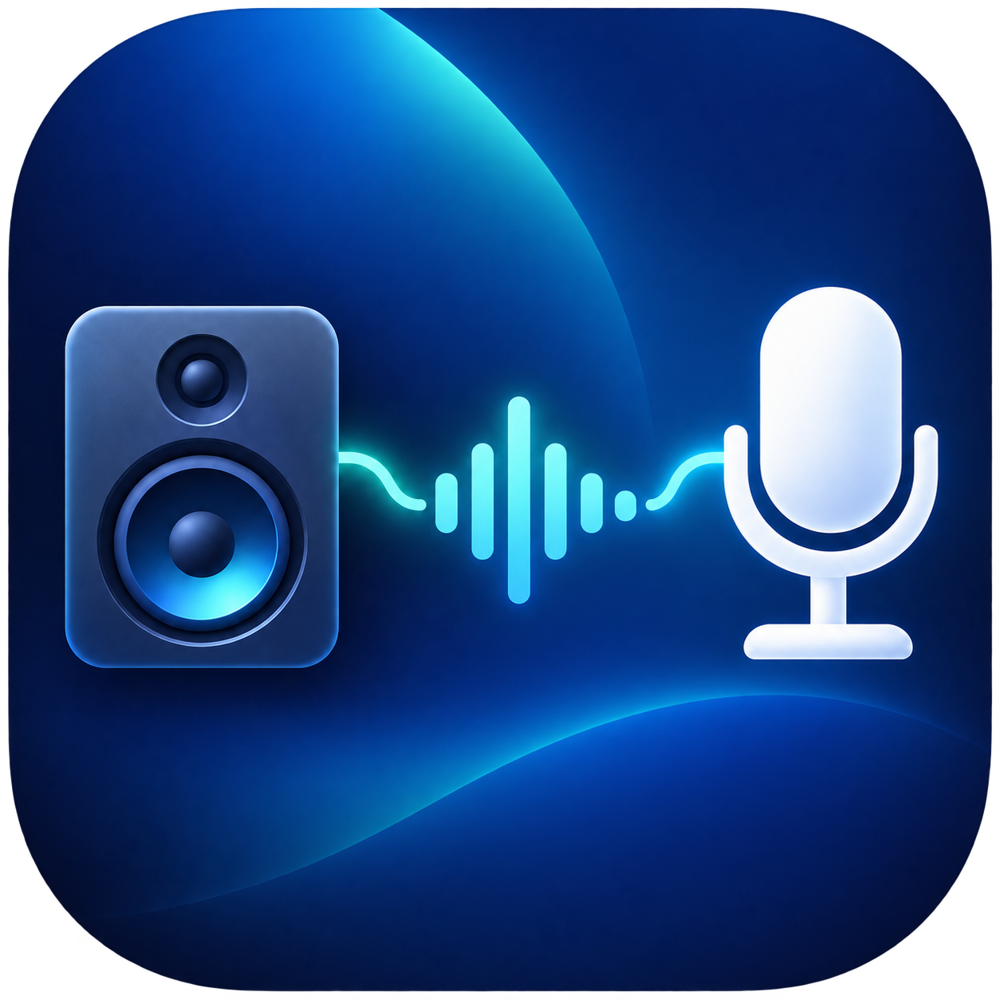
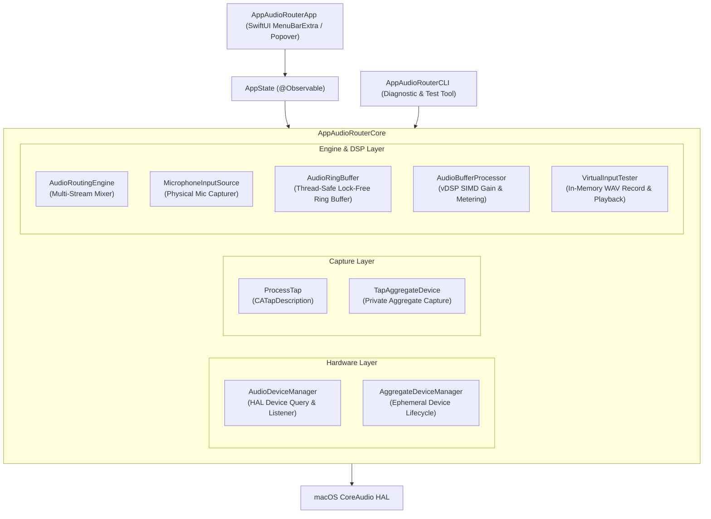
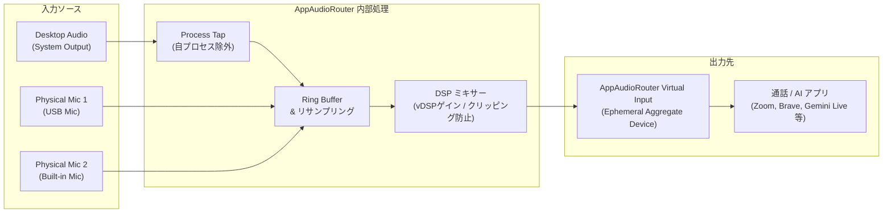
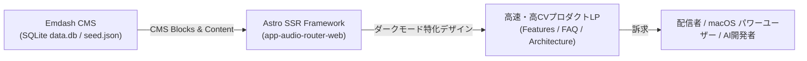

# AppAudioRouter

  
  <h3>macOS 14.2+ (Sonoma / Sequoia) 向けメニューバー常駐型 オーディオルーター＆ミキサー</h3>

`macOS 14.2+` `Swift 5.9+` `SwiftUI` `CoreAudio` `vDSP` `AI駆動開発`

 

> **カーネル拡張 (kext) や危険な常設ドライバは不要。**  
> macOS 14.2+ 公式の **CoreAudio Process Tap API** と動的な **エフェメラル集約デバイス (Ephemeral Aggregate Device)** を組み合わせ、デスクトップ全体の再生音声と複数の物理マイク音声をリアルタイムにミキシングして通話・配信アプリやブラウザAI（Zoom, Google Meet, Brave, Discord, Gemini Live 等）へ送出するネイティブデスクトップアプリケーションです。

---

## 💡 開発背景と解決課題

オンライン会議ツールや対話型AI（Gemini Live、音声入力エージェントなど）を利用する際、**「PCで再生している動画やシステムの音声」と「自分のマイクの声」を同時に相手（またはAI）に聴かせたい**というユースケースが頻繁に生じます。

従来の一般的なアプローチには以下の課題がありました：

1. **常設仮想オーディオドライバの管理問題**:
   - BlackHole や Soundflower などのサードパーティドライバは便利ですが、OSのシステム設定にデバイスが永続的に残り続け、入出力切り替え時の誤動作やトラブルの原因になりやすい。
2. **カーネル拡張やプロセスインジェクションのセキュリティリスク**:
   - アプリケーション音声を傍受するために特権的なフックや古いカーネル拡張を用いる方法は、近年の macOS のセキュリティポリシー（SIP、Notarization）と相性が悪い。
3. **自己フィードバック（ハウリング）の発生**:
   - 単純に出力音声を入力にループバックすると、相手の声や自分の音声が無限ループしハウリングを起こす。

**AppAudioRouter** は、macOS 14.2 で新設された公式の CoreAudio キャプチャ機構を徹底活用し、**「アプリ起動時だけ一時的に仮想マイクを作り、終了時には綺麗さっぱり自動破棄される」** クリーンで安全な音声ルーティング環境を実現しました。

---

## 🌟 主要機能

1. **アプリ起動中のみ現れる一時的仮想マイク (Ephemeral Virtual Input)**
   - アプリ起動時に macOS CoreAudio HAL 上で `AppAudioRouter Virtual Input`（機器セット）を自動生成。
   - アプリ終了時には自動破棄されるため、macOS のサウンド設定を汚しません。
   - 会議アプリやブラウザのマイク選択肢に即座に出現します。

2. **安全なデスクトップ音声キャプチャ (CoreAudio Process Tap API)**
   - `CATapDescription` を用いて、OSカーネルの奥深くに入り込むことなくシステム全体の音声をリアルタイムキャプチャ。
   - **自プロセス除外フィルタ機構** により、自己フィードバック（ハウリング）を根本から防止。

3. **マルチマイクの同時検知 & ミキシング**
   - 内蔵マイク、USBオーディオインターフェース、Bluetoothヘッドセットなど、接続された物理マイクを自動検出。
   - マイクごとに独立した **音量スライダー**、**ミュートスイッチ**、**仮想マイク送出切替**、**リアルタイムVUメーター** を提供。

4. **仮想マイク録音・再生テスト機能 (Self-Test)**
   - 仮想マイクへ送出中のミックス音声（デスクトップ音＋マイク音）をアプリ内で直接ワンタップ録音。
   - デフォルトスピーカーから即座にプレビュー再生でき、会議参加前に音量バランスや音質を確実に事前チェック可能。

5. **洗練されたネイティブUI (SwiftUI MenuBarExtra) + CLI 診断ツール**
   - メニューバーアイコンから瞬時に展開するポップオーバーUI。
   - ターミナルからオーディオデバイスの列挙、パイプライン診断、テストトーン送出が行える `AppAudioRouterCLI` を同梱。

---

## 🏗️ システムアーキテクチャ

AppAudioRouter は Swift Package Manager (SPM) をベースとし、UI層・状態管理層・オーディオエンジン層・ハードウェア制御層を明確に分離したモジュール設計を採用しています。

### 音声信号のルーティングフロー

---

## 🛠️ 技術的挑戦と実装のポイント

### 1. リアルタイムオーディオスレッドの制約と安全性 (Real-Time Safety)
CoreAudio の IOProc コールバックは、高優先度のリアルタイムスレッド（SCHED_FIFO / リアルタイム制約）で実行されます。
このスレッド内で以下を行うと、オーディオのドロップアウト（プチノイズ、音飛び）の原因となります：
- **ヒープメモリの動的確保・解放 (`malloc`, `free`, Swift のオブジェクト生成)**
- **ブロッキング同期（Mutex、セマフォ、ロック待ち）**
- **ファイルI/O やネットワーク通信**

AppAudioRouter では、あらかじめ固定サイズを確保した **ロックフリーな循環バッファ (`AudioRingBuffer`)** を自作し、プロデューサー（キャプチャコールバック）とコンシューマー（ミキサーコールバック）間でのゼロアロケーション・ロックフリー転送を徹底しています。

### 2. Apple Accelerate (vDSP) による高速ベクトル演算
複数のマイク音声とデスクトップ音声をミキシングする際、Apple Silicon / Intel CPU の SIMD ユニットを活用する `Accelerate.framework` (vDSP) を採用：
- `vDSP_vsmul`: 音量スライダーに応じた高速ゲイン調整
- `vDSP_vmaxmg`: ピーク音量の瞬時検出によるオーバーロード/クリッピング防止
- RMS（二乗平均平方根）計算による正確な VU メーター描画（60fps スムーズアニメーション）

### 3. エフェメラル集約デバイスの完全なライフサイクル管理
`AudioHardwareCreateAggregateDevice` API を使用して仮想入力デバイスをランタイムで動的生成します。
予期せぬアプリ強制終了やクラッシュ時にも残存デバイスを残さないよう、プロセスのシグナルハンドラおよび終了フック (`atexit`) でのクリーンアップ保証を実装しています。

---

## 📊 技術スタック

| 分類 | 技術・ツール |
| :--- | :--- |
| **開発言語** | Swift 5.9+ (Swift 6 準備対応) |
| **対応OS** | macOS 14.2 (Sonoma) 以上, macOS 15 (Sequoia) 確認済 |
| **GUI フレームワーク** | SwiftUI (`MenuBarExtra`, `@Observable`) |
| **オーディオ基盤** | macOS CoreAudio HAL, `CATapDescription`, AudioServerPlugIn / Aggregate Device |
| **信号処理 (DSP)** | Apple Accelerate Framework (`vDSP`) |
| **パッケージ管理** | Swift Package Manager (SPM) |
| **アーキテクチャ** | Apple Silicon (arm64) / Intel (x86_64) Universal Binary |

---

## 🌐 Emdash CMS による広報・マーケティングWebサイト ([`app-audio-router-web`](file:///app/app-audio-router-web))

AppAudioRouter の革新性（kext不要、一時的集約デバイス、Process Tap API）をユーザーや配信者にわかりやすく伝えるため、**Emdash CMS × Astro** による専用プロダクト紹介Webサイトを構築しています。

### Emdash Webサイトの構成と特徴
- **Emdash CMS 統合 (`app-audio-routrer`)**:
  - 管理画面（`/_emdash/admin`）から、主要な訴求ポイント（ノーkext、低レイテンシ、自プロセス除外）やよくある質問（FAQ）をノーコードで柔軟に更新可能。
  - SQLite ローカルデータベース（`data.db`）と `seed.json` によるバージョン管理可能なコンテンツ構成。
- **macOS ネイティブの雰囲気を体現した UI デザイン**:
  - プロ向けオーディオツールにふさわしいダークトーンの洗練されたビジュアル、VUメーターのグラフィック表現、Phosphor アイコン群。
- **技術解説とダウンロード導線**:
  - システム設定を汚さないクリーンな仕組みを図解し、ユーザーの安心感を醸成するプロダクトストーリーテリング。

---

## 🤖 AI駆動開発における役割分担（AI-Orchestration）

本プロジェクトは、最新の macOS 14.2 API 仕様への対応と難度の高い CoreAudio C API 統合、さらに Emdash 広報 Web の立ち上げまでを、**自律型AI協調開発（AI-Driven Development）** により短期間で具現化しました。

- **自身が担当した領域（アーキテクチャ設計・意思決定・検証）:**
  - 「kext（カーネル拡張）を使わず、起動時のみエフェメラル集約デバイスを作る」という全体アーキテクチャの基本設計
  - 自己ループによるハウリングを防止するための「自プロセス除外フィルタ（CATapDescription）」の仕様定義
  - リアルタイムIOProcスレッド内でのロック競合・メモリ確保禁止（リアルタイム安全性）の制約指示
  - 実機（macOS 14.2 / 15）における音声入出力・遅延・負荷テストおよびデバッグ
  - Emdash 広報サイトのコンテンツ戦略とターゲット層（配信者・対話AIユーザー）の定義
- **AIが加速した領域（高速プロトタイピング・ボイラープレート生成）:**
  - 難解な CoreAudio HAL C API（`AudioObjectGetPropertyData` 等）の Swift ラッパーボイラープレート生成
  - `vDSP` によるベクトル乗算・RMS音量計算関数の初期実装
  - SwiftUI（MenuBarExtra）UIコンポーネントのレイアウト構築
  - Emdash CMS スキーマ（`seed.json`）と Astro UI コンポーネントの自動スキャフォールディング

---

## 🔗 関連リンク & 配布

- **ネイティブアプリリポジトリ**: [`app-audio-router`](file:///app/app-audio-router)
- **Emdash広報Webサイト**: [`app-audio-router-web`](file:///app/app-audio-router-web)
- **詳細設計書**: システム仕様書 (`docs/specification.md`), アーキテクチャ設計書 (`docs/architecture.md`)
