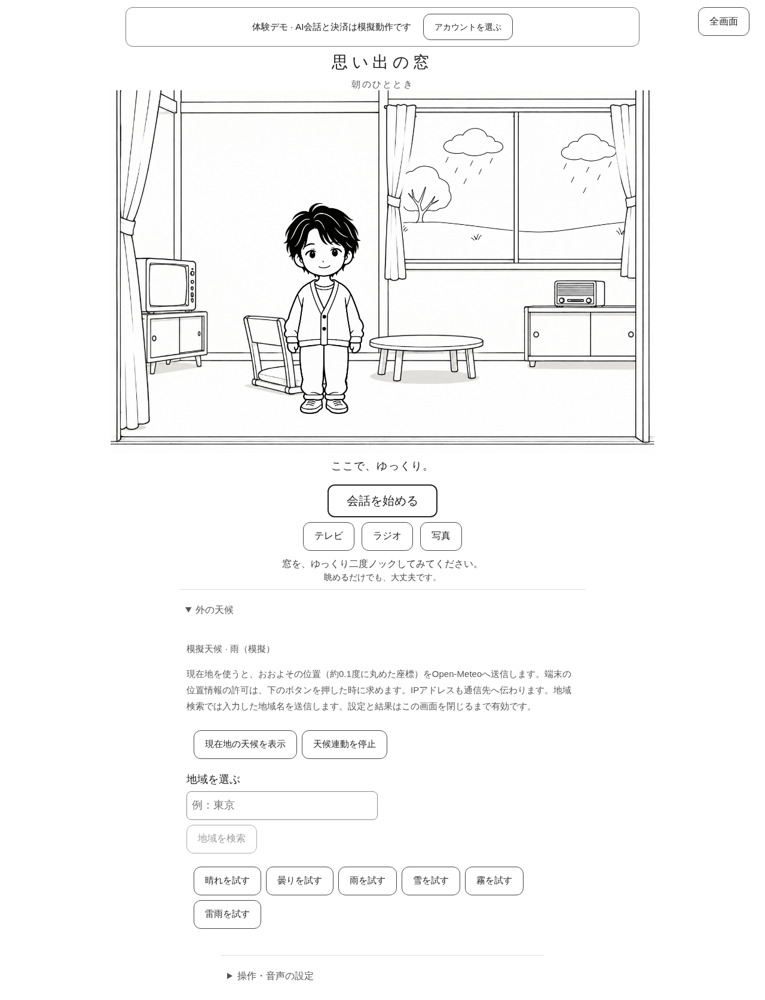
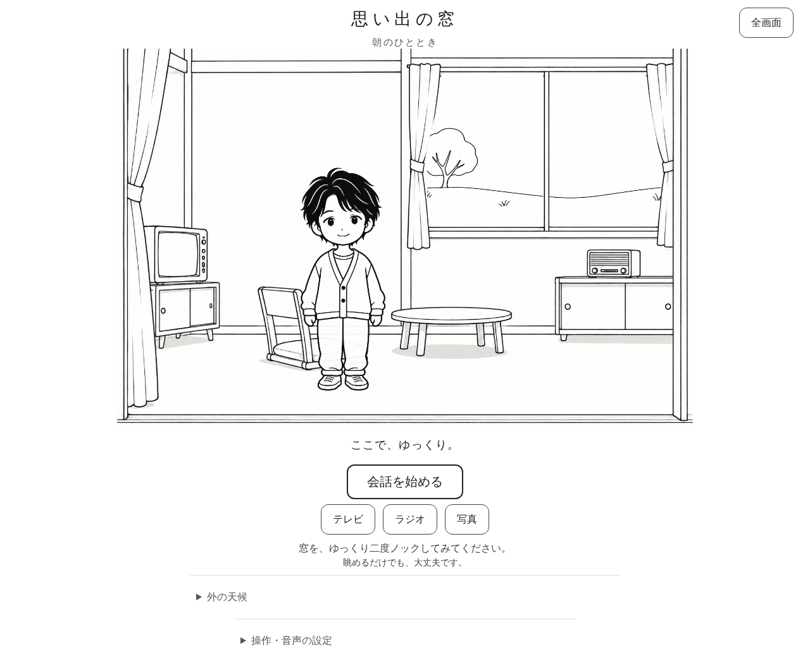
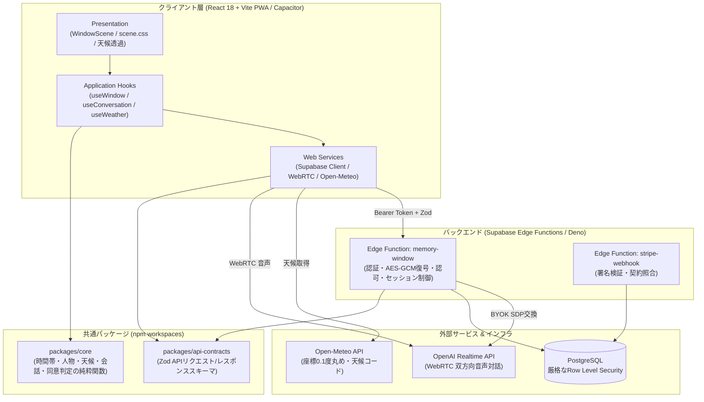

# 思い出の窓 (Memory Window)

  
  <h3>白黒線画の窓の向こうに、静かな小さな暮らしを描く遠隔見守り・生活リズム・対話支援システム</h3>

`React 18` `TypeScript` `Vite (PWA)` `Monorepo (npm workspaces)` `packages/core (Pure Domain)` `Zod (api-contracts)` `Supabase Edge Functions` `PostgreSQL (RLS)` `WebRTC Audio` `Capacitor` `AI駆動開発`

 

> **「監視カメラではなく、温かな窓の向こうの生活リズムとして見守る」**  
> 一人暮らしの高齢者や支援を必要とする当事者のプライバシーを最大限に尊重し、白黒線画の窓とキャラクターのアニメーションを通して、生活リズムの確認、AI音声対話、そして同意に基づく支援者共有を実現するWeb/PWAアプリケーションです。  
> 会話音声や全文を永続保存しないゼロ・リテンション設計と、厳格なRow Level Security (RLS) により、最高水準の医療福祉・プライバシーセキュリティを担保しています。

---

## 💡 開発背景と解決課題

遠隔見守りや介護支援の現場において、以下のような深刻なジレンマが存在していました：

1. **監視カメラに対する強い心理的抵抗感**:
   - 自宅内にカメラを設置されることはプライバシーの侵害と感じられ、当事者が強い拒否感やストレスを抱く。
2. **通話・対話のハードルの高さ**:
   - スマートフォンの操作やビデオ通話は身体的・認知的な負荷が高く、日常的なコミュニケーションが途絶えがちになる。
3. **生活困りごとの把握とプライバシーの摩擦**:
   - 「電球が切れた」「買い物がつらい」といった生活ニーズが家族や支援者に伝わりにくい一方、何でも筒抜けになることへの警戒感がある。

**思い出の窓（Memory Window）** は、**「線画の窓をノックするだけ」** という極めて直感的な身体操作と、**「本人が明示的に同意した困りごと項目だけを支援者へ共有する版管理機構」** によって、尊厳を守りながら孤立を防ぐ新しい見守り体験を形にしました。

---

## 🌟 主要機能

  

1. **線画の窓と生活リズムの可視化**:
   - 朝・昼・夕・夜のローカル時刻に連動し、窓の中のキャラクターが読書・食事・休息などの日常動作を行う。
   - 室内画像のガラス越しに、外の天候（雨・雪・晴れ・曇り）がリアルタイムに描画される。
2. **直感的なノックインタラクション**:
   - 窓を2回タップ（設定で1回タップに変更可能）または Enter/Space でノックすると、キャラクターが振り向いて手を振り、時間帯に応じた固定挨拶を話しかける。
3. **WebRTC によるリアルタイム AI 音声対話**:
   - OpenAI Realtime API を活用した自然な音声会話。マイクに向かって話しかけるだけで、低レイテンシな双方向会話が可能。
   - **ゼロ・リテンション**: 会話全文や生音声をサーバーDBへ永続保存せず、プライバシーを完全保護。
4. **生活ニーズ抽出 & 版付き同意による支援者共有**:
   - 会話の中から「電球の交換」「買い物代行」などの困りごと候補をルールベースで提示。
   - 利用者本人が内容を確認して非公開保存。招待コードで結ばれた支援者に対し、**本人が明示的に同意した項目だけ**が閲覧可能になる。
   - 編集・撤回・削除も本人の意思でいつでも即座に実行可能。
5. **BYOK (Bring Your Own Key) & AES-GCM 暗号化**:
   - 利用者独自のAPIキーを使用可能。サーバー側で利用者ごとに AES-GCM 暗号化して保管し、ブラウザには平文キーを返却しない。

---

## 🏗️ システムアーキテクチャ

単一の責務に閉じた npm workspaces モノレポ構造を採用し、ビジネスルールを UI フレームワークから完全に独立させています。

---

## 🛡️ プライバシー & セキュリティ設計

| 項目 | 実装方針 |
| :--- | :--- |
| **会話音声・テキスト** | アプリDBには永続保存しない。一時的セッション終了とともに完全破棄。 |
| **APIキー保管** | サーバー側で利用者別に AES-GCM 暗号化（`encrypted_api_keys`）。マスター暗号鍵はサーバー秘密環境変数に分離。 |
| **支援者共有データ** | `needs` と `consent_events` テーブル。所有者判定、版付き同意、有効な支援者権限（RLS）がすべて揃った場合のみ返却。 |
| **位置情報・天候** | 端末の現在地座標は 0.1 度（約11km四方）へ丸め、画面メモリ上のみに保持。DBへは一切保存しない。 |
| **支援者招待** | 招待コードはハッシュ化保存（`care_invites`）。24時間有効期限かつ1回限定使用。 |

---

## 🤖 AI駆動開発 (AI-Driven Development) における実践

本プロジェクトは、ソフトウェア要求仕様書（SRS v2.0）に基づく段階的リリース計画（Phase 0〜7）を、AI コーディングエージェントとの協調により体系的に完遂させました。

### 役割分担（人間の意思決定 vs AIの高速化）
- **自身が担当した領域（福祉工学ドメイン・倫理設計・アーキテクチャ）:**
  - 「カメラによる監視ではなく、アニメーションとノックによる生活気配の伝達」という基本コンセプトの定義
  - 本人の自己決定権を守るための「版付き同意（Consent Events）と項目単位の共有制御」の仕様設計
  - OpenAI Realtime の費用上限・利用時間制限（日次1800秒上限等）の安全弁設計
- **AIが加速した領域（型定義・純粋関数・自動テスト）:**
  - UIに依存しないドメインロジック（`packages/core`）の TDD（テスト駆動開発）実装
  - Zod スキーマ（`packages/api-contracts`）によるフロント・バックエンド間の型安全性の完全自動保証
  - Deno 環境における Edge Functions の型チェック（`deno check`）と単体テストの自動化
  - Playwright E2E テストによるノック・会話・同意・支援者切り替えシナリオの網羅

---

## 📊 技術スタック

| 分類 | 技術 / ライブラリ | バージョン / 詳細 |
| :--- | :--- | :--- |
| **フロントエンド** | React 18, TypeScript, Vite | PWA 対応、レスポンシブ CSS アニメーション |
| **モノレポ管理** | npm workspaces | `apps/web`, `packages/core`, `packages/api-contracts` |
| **ドメインロジック** | Pure TypeScript (`packages/core`) | 外部SDK非依存、100%単体テスト可能 |
| **スキーマバリデーション** | Zod (`packages/api-contracts`) | クライアント / サーバー間契約の共通化 |
| **バックエンド / DB** | Supabase Edge Functions, PostgreSQL | Deno 2.9+, Row Level Security (RLS) |
| **リアルタイム通信** | WebRTC, OpenAI Realtime API | 双方向低遅延音声対話 |
| **モバイル対応** | Capacitor | iOS / Android ネイティブコンテナ同期 |
| **テスト** | Vitest, Deno Test, Playwright | E2E および単体・結合テスト自動化 |

---

## 🔗 ディレクトリ & 関連リンク

- **リポジトリ**: [`memory-window`](file:///app/memory-window)
- **システムアーキテクチャ仕様書**: [システムアーキテクチャ仕様書](file:///app/memory-window/docs/architecture/system-architecture.md)
- **実サービス接続と安全設定**: [実接続手順書](file:///app/memory-window/docs/operations/connected-services.md)
- **全フェーズ計画書**: [SRS v2.0 フェーズ対応仕様書](file:///app/memory-window/docs/specifications/all-phases-plan.md)
