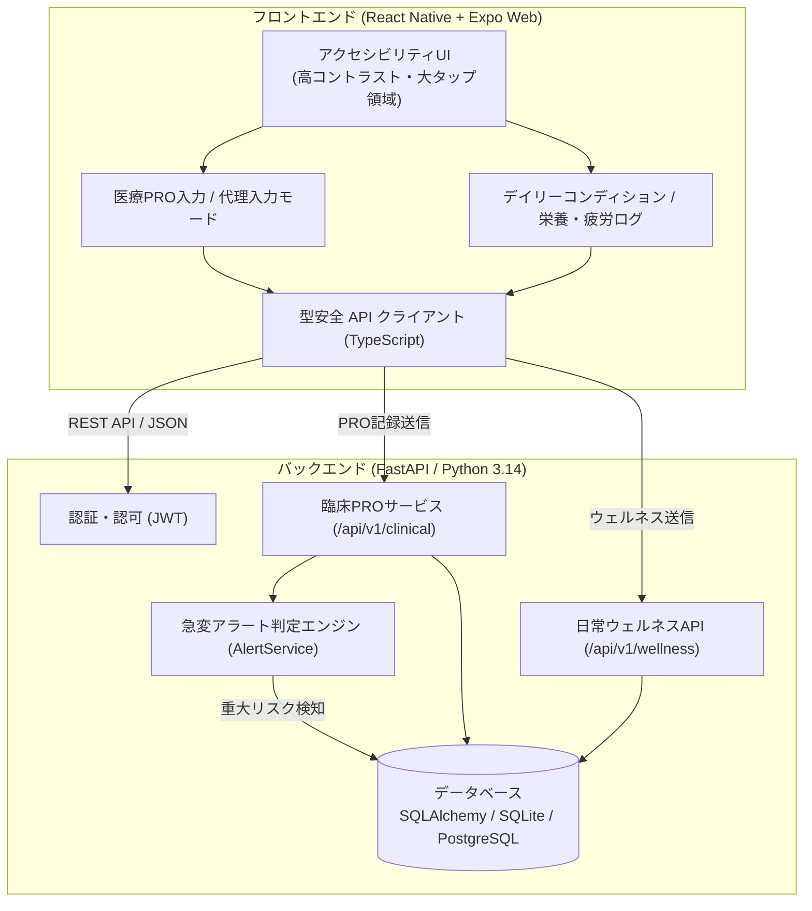

# MyoLink（マイオリンク）

<div class="project-badges" markdown>
`FastAPI (Python 3.14)` `React Native / Expo Web` `SQLAlchemy` `Pydantic v2` `ALSFRS-R / MG-ADL` `Accessibility UI` `AI駆動開発`
</div>

**神経・筋疾患（ALS、重症筋無力症、筋ジストロフィー等）患者向けの高精度医療用PRO（Patient-Reported Outcome：患者報告アウトカム）収集機能と、一般層・軽症者向けの日常コンディショニング・疲労管理機能を統合したハイブリッド・ヘルスケアアプリケーションです。**

---

## 💡 開発の背景と課題意識

進行性神経筋疾患においては、日々の微細な筋力低下、疲労感の蓄積、嚥下や呼吸器症状の変動を**継続的かつ正確にモニタリングすること**が、早期の治療介入や急性増悪の防止に直結します。

しかし、既存の医療システムや記録ツールには以下の課題がありました：

1. **患者側の入力負荷・アクセシビリティの欠如**:
   - 上肢に障害や筋力低下を持つ当事者にとって、一般的なスマートフォンアプリの小さなUIボタンや複雑な画面遷移は入力そのものが過大な身体的負担となります。
2. **医療標準評価（PRO）と日常記録の分断**:
   - 医療機関で求められる国際標準の臨床評価尺度（ALSFRS-R, MG-ADL等）と、日常の体調・栄養・疲労ログが分離しており、患者が二重の手間を強いられていました。
3. **急変アラートと介助者連携の不在**:
   - 呼吸機能や嚥下機能の急激な悪化を検知し、家族や医療チームへ自動通知する安全網、および患者自身が操作困難な際に介助者が代理入力できる仕組みが不足していました。

こうした課題に対し、**10年以上のNPO理事経験と福祉工学の実践知見**を背景に、**AI駆動開発（AI-Driven Development）** の手法を駆使して高速・堅牢に設計・実装されたのが本プラットフォーム「**MyoLink**」です。

---

## 🏗️ システムアーキテクチャ

マルチプラットフォーム（iOS / Android / Web）を単一コードベースでカバーする Expo / React Native for Web と、Python 3.14 + uv による超高速な FastAPI 非同期バックエンドで構成されています。



---

## 🌟 主要機能とコアドメイン

### 1. 標準化医療PRO評価 (ALSFRS-R & MG-ADL 準拠)
神経筋疾患の臨床評価尺度である ALSFRS-R および MG-ADL の評価軸に基づき、患者の主訴を定量スコアリングします。

- **5大ドメインの評価**:
  - `swallowing_score`（嚥下機能）
  - `speech_score`（構音・発話）
  - `respiratory_score`（呼吸困難度）
  - `upper_limb_score`（上肢動作・書字・整容）
  - `lower_limb_score`（下肢・起立・歩行）
- 各項目 0（正常）〜 4（重度機能喪失）の5段階でスコアリングし、総合重症度スコア（0〜20点）を時系列追跡。

```python
# 臨床PRO評価モデルの定義 (backend/app/models/clinical.py)
class ProAssessment(Base):
    __tablename__ = "pro_assessments"

    id = Column(Integer, primary_key=True, index=True)
    patient_id = Column(Integer, ForeignKey("users.id"), nullable=False, index=True)
    recorded_by_user_id = Column(Integer, ForeignKey("users.id"), nullable=False)
    is_proxy = Column(Boolean, default=False, nullable=False)  # 介助者による代理入力フラグ
    assessment_date = Column(String, nullable=False, index=True)

    # 5領域スコア
    swallowing_score = Column(Integer, nullable=False)
    speech_score = Column(Integer, nullable=False)
    respiratory_score = Column(Integer, nullable=False)
    upper_limb_score = Column(Integer, nullable=False)
    lower_limb_score = Column(Integer, nullable=False)
    total_score = Column(Integer, nullable=False)
    notes = Column(Text, nullable=True)
```

### 2. 急変アラート判定エンジン (Clinical Alert Engine)
PROデータが記録された瞬間、バックエンドのルールベース・エンジニアリングが稼働。特に生命維持に直結する**呼吸（respiratory）**および**嚥下（swallowing）**の閾値違反や、前回測定からの急激な悪化（Rapid Decline）を即座に検知し、未確認アラートを発行します。

```python
# 臨床アラート判定ロジック (backend/app/services/alert_service.py 抜粋)
def evaluate_assessment_alerts(assessment: ProAssessment, db: Session) -> list[ClinicalAlert]:
    alerts = []
    
    # 呼吸器系の重篤化検知
    if assessment.respiratory_score >= 3:
        alerts.append(ClinicalAlert(
            patient_id=assessment.patient_id,
            assessment_id=assessment.id,
            alert_type="RESPIRATORY_CRITICAL",
            severity="CRITICAL",
            message="呼吸困難スコアが危険水準に達しています。医療機関への連絡を検討してください。"
        ))
    
    # 嚥下機能の急変検知
    if assessment.swallowing_score >= 3:
        alerts.append(ClinicalAlert(
            patient_id=assessment.patient_id,
            assessment_id=assessment.id,
            alert_type="SWALLOWING_CRITICAL",
            severity="WARNING",
            message="誤嚥・嚥下障害のリスクが高まっています。"
        ))
    return alerts
```

### 3. 当事者本位のアクセシビリティ＆代理入力（Caregiver Mode）
- **高コントラスト & 大型タッチターゲット**: 手指の巧緻性が低下している状態でも誤タップを防ぐエルゴノミックUI。
- **介助者代理記録 (`is_proxy`)**: 患者本人の発話・指先操作が困難な日には、登録された介助者（Caregiver）アカウントから安全に代理入力が可能。監査ログとして「誰が記録したか」を厳格に保持。

### 4. 日常コンディショニング＆栄養・疲労管理
疾患管理だけでなく、日々の疲労レベル（Fatigue Score）、睡眠時間、PFCバランスマクロ栄養素（タンパク質・脂質・炭水化物・カロリー）、リハビリ・運動記録を統合管理。継続的なストリーク表示で入力モチベーションを支えます。

---

## 🤖 AI駆動開発 (AI-Driven Development) の実践

本プロジェクトでは、開発プロセスの全工程において**最新AIエージェントとの協調エンジニアリング（AI-Orchestration）**を導入し、品質と開発速度を最大化しました。

### 役割分担（人間の意思決定 vs AIの高速化）
- **自身が担当した領域（ドメイン設計・意思決定・総合検証）:**
  - 10年以上のNPO理事経験に基づく臨床課題抽出（PRO尺度 ALSFRS-R / MG-ADL の選定、介助者代理入力の必要性）
  - システムアーキテクチャの選定（Expo Web + FastAPI + uv）とデータモデル仕様策定
  - 急変アラート（呼吸・嚥下スコア急低下）の臨床的閾値ルール定義
  - 生成されたAPIとフロントエンドUIの統合動作確認・アクセシビリティ検証
- **AIが加速した領域（高速生成・網羅的検証）:**
  - Pydantic v2 と SQLAlchemy モデルのボイラープレート生成
  - pytest による境界値・エッジケース網羅テストスイートの自動生成
  - OpenAPI スキーマからの TypeScript 型同期クライアント生成

### 1. 医療ドメインモデリングの高速化
複雑な神経筋疾患の臨床指標（ALSFRS-R, MG-ADL）や階層的ユーザー権限モデル（患者・介助者・研究者）のスキーマ設計を、ドメイン駆動設計（DDD）の文脈でAIと対話しながら迅速にモデリング。Pydantic v2 と SQLAlchemy 間の型整合性をゼロから堅牢に構築しました。

### 2. pytest による包括的テストスイートの自動生成
- 臨床スコア計算・閾値アラートロジックの全エッジケース（境界値テスト）
- JWT認証、権限分離（他患者データのアクセス遮断）テスト
- ポート8080でのE2E検証スクリプト（`./scripts/test_port_8080.sh`）
これらをAIを活用して自動整備し、リファクタリング耐性の高いテストカバレッジを実現しました。

### 3. フロントエンド・バックエンドの型安全同期
バックエンドの OpenAPI スキーマを元に、React Native 側の TypeScript 型定義および API クライアントを自動同期。通信エラーや型不一致による不具合を排除しました。

---

## 🛠️ 技術スタック一覧

| レイヤー | 技術 / ライブラリ | 採用理由・役割 |
| :--- | :--- | :--- |
| **Backend** | Python 3.14, FastAPI, uv | 高速なASGI非同期処理、最新の型ヒント、高速な依存解決 |
| **Data Layer** | SQLAlchemy, Pydantic v2 | 堅牢なORMマッピングと厳格なスキーマバリデーション |
| **Frontend** | React Native, Expo SDK, TypeScript | iOS/AndroidネイティブおよびWebブラウザのクロスプラットフォーム展開 |
| **UI/UX** | React Native for Web, Custom Theme | アクセシビリティ（A11y）準拠、大型ターゲット、高コントラスト設計 |
| **DevOps & QA**| Docker, Zellij, Pytest, Shell Scripting | 再現性の高い開発コンテナ環境と自動テストパイプライン |
| **広報・Web展開**| Emdash CMS, Astro | 医療・福祉関係者および当事者向けの解説・啓蒙Webサイト基盤 |

---

## 🌐 Emdash CMS による広報・啓蒙Webサイト計画 ([`myo-link-web`](file:///app/myo-link-web))

難病当事者、ご家族、医療・訪問看護チームに向けた啓蒙およびプロダクト紹介を行うため、**Emdash CMS × Astro** をベースとしたWeb情報発信基盤（[`myo-link-web`](file:///app/myo-link-web)）の立ち上げを進めています。

- **医療福祉関係者向け信頼性コンテンツ**:
  - ALSFRS-R / MG-ADL 臨床PROの収集意義や、急変アラート判定アルゴリズムの信頼性をわかりやすく解説。
- **当事者フレンドリーなアクセシブルWebデザイン**:
  - スクリーンリーダー、ハイコントラスト、大きなフォントサイズに対応した Emdash テーマ設計。
- **AI駆動での高速コンテンツ管理**:
  - `seed.json` と SQLite を活用し、臨床プロトコルの変更や最新の治験情報を迅速に更新可能。

---

## 🔗 ディレクトリ & 関連リンク

- **アプリケーションリポジトリ**: [`myo-link`](file:///app/myo-link)
- **Emdash広報Webサイト**: [`myo-link-web`](file:///app/myo-link-web)
- **バックエンドAPI**: FastAPI (`/api/v1/clinical`, `/api/v1/wellness`)

