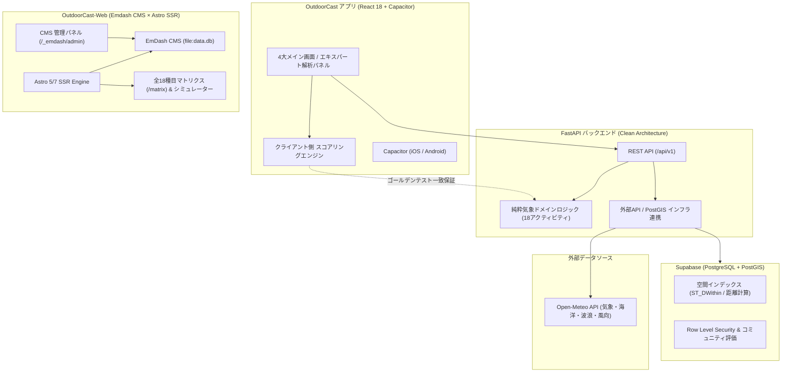

# OutdoorCast (Cross-Platform) & Emdash Official Web

  
  <h3>18のアクティビティに特化した行動判断気象判定プラットフォーム & Emdash 公式プロダクトWeb</h3>

`React 18` `Capacitor (iOS/Android)` `FastAPI` `Python 3.12+` `Clean Architecture` `Supabase (PostGIS)` `Emdash CMS` `Astro SSR` `AI駆動開発`

 

> **「天候・波浪・風向を専門解析し、アウトドアの安全と最高の体験を支える」**  
> サーフィン、SUP、釣り、キャンプ、登山、スノースポーツなど**全18種類のアウトドアアクティビティ**を網羅し、気象データ（Open-Meteo）と専門エキスパート知見を直結させたクロスプラットフォーム意思決定システムです。  
> また、18種目のマトリクス対照表やシミュレーターを備えた公式解説・広報サイト（[`outdoor-cast-web`](file:///app/outdoor-cast-web)）は、**Emdash CMS × Astro SSR** によるAI駆動開発で構築されています。

---

## 💡 開発背景と解決課題

マリン・山岳・スノーをはじめとするアウトドアアクティビティにおいて、**天候・風・波の条件は体験の満足度だけでなく、生命の安全に直結する決定打**です。

1. **一般天気予報の粒度不足**:
   - 単に「晴れ / 曇り」といった情報では、サーフィンの「オフショアかオンショアか、うねり周期」、登山の「稜線風速・気温急変」、SUPの「沖合強風による漂流リスク」といったクリティカルな判断が下せない。
2. **多種目アクティビティの専門知識の壁**:
   - 種目ごとに最適な条件や危険中止ラインが異なり、初心者が独自に気象図から判断することは困難。
3. **モバイルネイティブとWeb広報の連携**:
   - フィールドで即座に使えるモバイルアプリ（iOS/Android/Web）と、詳細な仕様や安全基準を解説するマーケティングWebがシームレスに連携する必要があった。

**OutdoorCast** は、高解像度気象データ解析とPostGIS空間検索を統合したモノレポ基盤と、Emdash CMS によるリッチな解説Webサイトの両輪で、この課題を包括的に解決しました。

---

## 🌟 システム構成と2大プロジェクト

本ソリューションは、コアアプリケーション（[`outdoor-cast`](file:///app/outdoor-cast)）と、Emdash広報解説Web（[`outdoor-cast-web`](file:///app/outdoor-cast-web)）の2つのプロジェクトから構成されています。

### 1. OutdoorCast コアアプリケーション ([`outdoor-cast`](file:///app/outdoor-cast))
- **フロントエンド (React 18 + Vite + Tailwind + Capacitor)**:
  - 4大メイン画面:
    1. **Dashboard**: 現在地・お気に入りスポットの気象概要とリアルタイムコンディション判定
    2. **ActivityDetail**: 18アクティビティ個別の詳細スコア（0〜100点）、5大エキスパート専用解析パネル
    3. **SpotsCommunity**: PostGIS空間距離検索（ST_DWithin）、自律型コミュニティ実況・ピアレビュー承認
    4. **SeasonalGear**: 春夏秋冬の四季変動マスターと必携安全装備ガイド
  - iOS / Android（Capacitor）および Web（Cloudflare Pages）のマルチプラットフォーム展開。
- **バックエンド (FastAPI + Clean Architecture)**:
  - クリーンアーキテクチャ（Domain, Application, Infrastructure, Presentation）による疎結合設計。
  - 純粋気象スコアリングエンジンと5大専門エキスパート判定（海洋・気流・日照・降水・熱力学）。
  - TypeScriptクライアントとPythonバックエンドの計算結果が完全一致することを保証する**ゴールデンテスト**スイート。
- **データベース (Supabase PostgreSQL + PostGIS)**:
  - 全国56箇所のマスターシードデータと空間インデックスによる超高速検索、Row Level Security (RLS)。

### 2. Emdash 公式解説・プロダクトサイト ([`outdoor-cast-web`](file:///app/outdoor-cast-web))
- **Astro SSR × Emdash CMS 1.1**:
  - SQLite（`data.db`）および `seed.json` を基盤とするモダンヘッドレスCMS。
  - 管理画面（`/_emdash/admin`）からブロック、メニュー、設定を直感的に更新可能。
- **18アクティビティ完全対照マトリクス (`/matrix`)**:
  - スノー、マリン、山岳、スカイ、光学・自然観察、陸上ロードの全18種目の天候左右要因、最適条件、危険中止ライン、四季変動を完全網羅。
- **行動判定シミュレーター**:
  - サーフィン、キャンプ、スノーボード、ボルダリング、釣り、天体観測のリアルタイムスコアリングとアドバイスをWeb上でインタラクティブに体験。
- **多言語対応 (JA / EN) & Phosphor Icons**:
  - 言語スイッチャーによる即時切り替え、洗練されたアウトドアアイコンシステム。

---

## 🏗️ システムアーキテクチャ

---

## 🤖 AI駆動開発 (AI-Driven Development) における実践

本プロジェクトは、複雑な気象物理モデルと膨大なアクティビティ仕様を、AI エージェントと人間エンジニアの高度なオーケストレーションによって具現化しました。

### 役割分担（人間の意思決定 vs AIの高速化）
- **自身が担当した領域（アウトドア要件・アーキテクチャ設計・総合検証）:**
  - 18種のアクティビティにおける危険・中止ライン（例: SUPのオフショア漂流リスク、登山の稜線風速限界）のドメイン定義
  - クリーンアーキテクチャに基づくモノレポ構成（frontend / backend / supabase / contracts）の全体設計
  - Emdash CMS を活用した広報戦略と、マトリクス対照表（`/matrix`）のコンテンツ設計
- **AIが加速した領域（高速生成・ゴールデンテスト・CMSスキャフォールディング）:**
  - 全18アクティビティ気象左右要因マスターの体系的ドキュメント化
  - TypeScript と Python のスコアリング計算一致を検証するゴールデンテストスイートの自動実装
  - 全国56スポットの緯度経度・海況特性シードSQLの自動生成
  - Emdash CMS スキーマ（SQLite）、Astro SSR ルーティング、Phosphor Icons の UI 構築

---

## 📊 技術スタック

| 対象 | レイヤー | 技術 / ツール | 役割 |
| :--- | :--- | :--- | :--- |
| **OutdoorCast アプリ** | フロントエンド | React 18, Vite, Tailwind CSS | 高速HMR、レスポンシブUI、動的線画アニメーション |
| | ネイティブコンテナ | Capacitor | iOS / Android ネイティブアプリ出力 |
| | バックエンド | FastAPI, Python 3.12+ | Clean Architecture、純粋気象ドメインロジック |
| | データベース | Supabase (PostgreSQL + PostGIS) | 空間インデックスによる高速距離検索、RLS |
| | 気象データ | Open-Meteo API | グローバル気象・海洋・波浪・潮汐データ |
| **OutdoorCast-Web** | CMS 基盤 | Emdash 1.1 (`emdash/astro`, `emdash/ui`) | ブロック管理、管理画面、ローカルSQLite (`data.db`) |
| | Web フレームワーク | Astro (SSR / `@astrojs/node`) | サーバーサイドレンダリング、超高速Webサイト |
| | スタイリング / アイコン | Phosphor Icons, CSS Tokens, Theme Layers | 18種目マトリクス表、気象シミュレーターUI |

---

## 🔗 ディレクトリ & 関連リンク

- **コアアプリケーション**: [`outdoor-cast`](file:///app/outdoor-cast)
- **Emdash広報Webサイト**: [`outdoor-cast-web`](file:///app/outdoor-cast-web)
- **システム仕様書 & ロードマップ**: [SYSTEM_ARCHITECTURE_AND_ROADMAP.md](file:///app/outdoor-cast/docs/SYSTEM_ARCHITECTURE_AND_ROADMAP.md)
