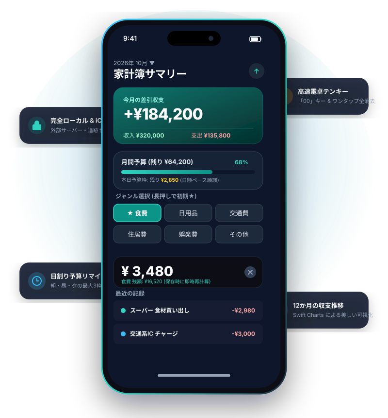
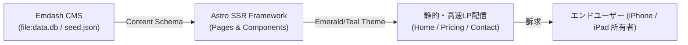
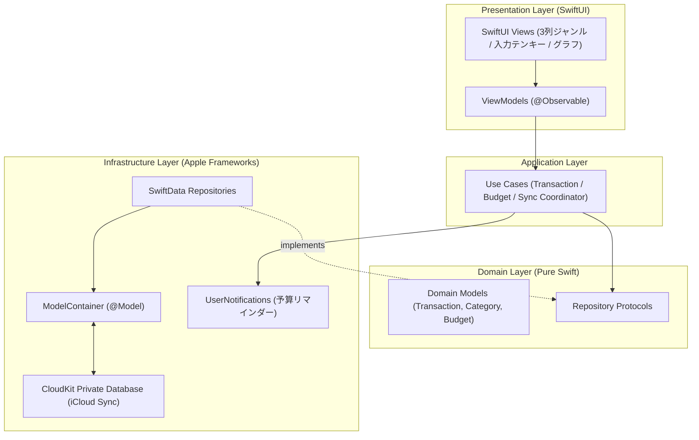

# Personal Kakeibo（家計簿）

  
  <h3>日常の収支を最少の手間で記録する iOS・iPadOS 17+ 向け個人用家計簿 & Emdash 公式Web</h3>

`iOS 17+` `iPadOS 17+` `Swift 6` `SwiftUI` `SwiftData` `Swift Charts` `CloudKit Private Database` `Emdash CMS` `Astro` `AI駆動開発`

 

> **「毎日続けられる、最速の入力体験と完全なプライバシー保護」**  
> 独自サーバーや広告、外部トラッキングを一切排除し、Apple純正の **SwiftData** と **iCloud Private Database (CloudKit)** のみでセキュアに同期する個人用家計簿アプリです。  
> また、プロダクトの価値を伝える広報・マーケティングサイト（[`personal_kakeibo-web`](file:///app/personal_kakeibo-web)）は **Emdash CMS × Astro** を採用し、AI駆動開発により短期間で高品質に立ち上げられました。

---

## 💡 開発背景と解決課題

市販の家計簿アプリには多機能なものが多い反面、以下のような実利用上のストレスや懸念が存在していました：

1. **過剰な機能と入力の遅延**:
   - 画面起動から金額入力完了までに複数のタップや画面遷移が必要で、日々の継続ハードルが高くなってしまう。
2. **クラウド外部サーバーへの個人資産データ蓄積とプライバシー懸念**:
   - 外部事業者の独自DBに収支情報が保存され、アカウント登録や広告表示、第三者トラッキングが発生する。
3. **オフライン耐性とデバイス間同期のトレードオフ**:
   - オフラインで軽快に動作しつつ、同じApple Accountを持つ iPhone と iPad の間でシームレスに同期する信頼できるアーキテクチャが少ない。

**Personal Kakeibo** は、**「最速の入力UI」** と **「端末内ローカルファースト ＋ Apple純正プライベートクラウド同期」** を両立させ、ストレスゼロで資産推移を把握できる体験を追求しました。

---

## 🌟 ネイティブアプリ（iOS / iPadOS）の主要機能

  

1. **3列ジャンル選択 & 長押し初期固定**:
   - 画面遷移なしで即座にジャンルを選択。よく使うジャンルを長押しすると起動時のデフォルトとして記憶（★マーク表示）。
2. **高速電卓ライクな入力テンキー**:
   - 「00」キー、金額のワンタップ全消去ボタン、スワイプでのメモキーボード収納など、親指一本で完結するテンキー操作。
3. **ジャンル別 日額・月額予算マネージャー**:
   - 食費や日用品などの上限を設定。入力直後に「本日・当月の残額」をリアルタイム計算・即時フィードバック。
4. **最大3枠のカスタム・リマインダー通知**:
   - 朝（7:00）・昼（12:00）・夕（18:00）などの生活リズムに合わせ、1日の残り予算や繰り返し収支予定をローカル通知。
5. **Swift Charts による視覚的分析**:
   - 月別収支、カテゴリ別支出円グラフ、12か月の収支トレンド推移を流麗なネイティブチャートで描画。
6. **完全ローカル保存 & CloudKit 同期**:
   - 独自サーバー不要。端末内保存（SwiftData）と iCloud Private Database で他端末へ自動同期。
7. **CSV出力 & プレビュー付き JSON バックアップ・復元**:
   - 外部Excel・スプレッドシート連携用CSV出力に加え、スキーマバージョン互換（軽量マイグレーション）を備えたJSON完全復元をサポート。

---

## 🌐 Emdash CMS による広報・マーケティングWebサイト ([`personal_kakeibo-web`](file:///app/personal_kakeibo-web))

プロダクトの普及と価値訴求のため、ヘッドレス/モダンCMS **Emdash** と **Astro** を組み合わせた専用LPサイトを構築しました。

### Emdash Webサイトの特徴
- **ブロック指向コンテンツ管理**:
  - 管理画面（`/_emdash/admin`）を通じて、ヒーロー、機能ハイライト、料金ポリシー、FAQのブロックを非エンジニアでも直感編集可能。
- **ゼロコスト・プライバシー重視の料金訴求**:
  - 完全無料・広告なし・iCloud同期による「安心感」を明確に打ち出す価格設計ページ（`/pricing`）。
- **Appleデザイン親和性**:
  - iOS標準に調和したエメラルド/ティールトーンのカラーパレット、ベクターモックアップ（`hero-visual.svg`）、ライト/ダーク/システム自動切替テーマスイッチャー。

---

## 🏗️ システムアーキテクチャ

ネイティブアプリ側は、SwiftData と CloudKit の仕様に準拠したクリーンなモジュラーモノリス構造を採用しています。

---

## 🤖 AI駆動開発 (AI-Driven Development) における実践

本プロジェクトでは、ネイティブ Swift 実装と Emdash 広報 Web の両軸において、自律型 AI エージェントとの緊密なオーケストレーションを実施しました。

- **人間エンジニアの意思決定領域:**
  - 「独自DBを作らず、完全なローカルファースト ＋ CloudKit Private Database でプライバシーを担保する」というアーキテクチャ方針の策定
  - 3列ボタンUI、親指操作テンキー、長押し固定など、実用性に直結するUX要件の定義
  - Emdash CMS による広報サイトのコンテンツ構造とトーン＆マナーの設計
- **AIエージェントによる加速領域:**
  - XcodeGen 仕様（`project.yml`、`project-cloud.yml`）および CloudKit Entitlements 設定スクリプト（`configure_cloud.py`）の自動生成
  - SwiftData `@Model` とドメインモデルの双方向マッピングおよび単体テストスイート（XCTest）の構築
  - Emdash CMS スキーマ（`seed.json`）と Astro UI コンポーネント、レスポンシブ CSS トークンの高速スキャフォールディング

---

## 📊 技術スタック

| 対象 | レイヤー | 技術 / ツール | 役割 |
| :--- | :--- | :--- | :--- |
| **iOS / iPadOS アプリ** | UI / View | SwiftUI, Swift Charts | ネイティブコンポーネント、流麗なアニメーションとチャート |
| | 言語・実行環境 | Swift 6, iOS 17+, iPadOS 17+ | モダン並行処理（`@MainActor`、Structured Concurrency） |
| | 永続化 & 同期 | SwiftData, CloudKit Private DB | ローカルSQLite抽象化と安全なiCloud自動同期 |
| | ビルド管理 | XcodeGen, Swift Package Manager | 再現性のある `.xcodeproj` 自動生成 |
| **広報・宣伝 Web** | CMS | Emdash CMS (`data.db`, SQLite) | ブロック単位のコンテンツ管理、直感的管理パネル |
| | Web基盤 | Astro (SSR / Node / Static) | 超高速ページ生成、TypeScript |
| | デザイン / UI | Phosphor Icons, CSS Tokens, SVG | 高精細モックアップ、ダーク/ライトテーマ切り替え |

---

## 🔗 ディレクトリ & 関連リンク

- **iOS/iPadOSアプリ**: [`personal_kakeibo`](file:///app/personal_kakeibo)
- **Emdash広報Webサイト**: [`personal_kakeibo-web`](file:///app/personal_kakeibo-web)
- **開発仕様書**: [開発仕様書 v2.1](file:///app/personal_kakeibo/docs/development-specification.md)
- **実機検証手順**: [実機確認手順書](file:///app/personal_kakeibo/docs/device-validation.md)
