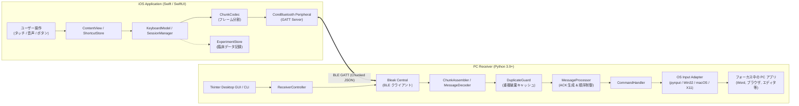
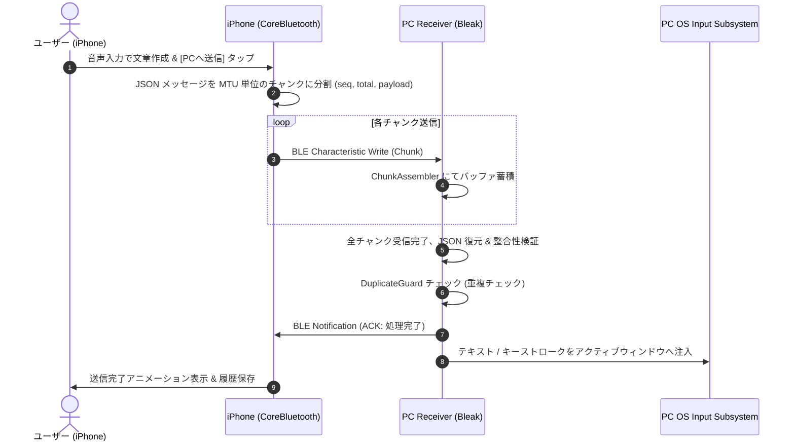
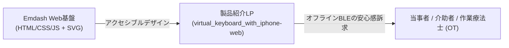

# VirtualKeyboard with iPhone

  
  <h3>iPhone を PC (Mac / Windows / Linux) のアクセシブルな入力サーフェスに変える福祉支援システム</h3>

`iOS` `Swift` `Python` `BLE` `Accessibility` `Assistive-Tech` `AI駆動開発`

 

> **「使い慣れたスマートフォンの操作性で、PCの自由な入力を取り戻す」**  
> 上肢や手指の筋力・可動域に制限のある方々のために開発された、iOS デバイス（iPhone / iPad）と PC（Mac / Windows / Linux）を Bluetooth Low Energy (BLE) で直結するクロスプラットフォーム入力支援システムです。
> iOS 標準のタッチキーボード、フリック入力、高精度な音声ディクテーション、巨大なカスタマイズ可能ショートカットキー、仮想トラックパッドを組み合わせ、PC への確実なテキスト入力とキーストローク注入を実現します。

---

## 💡 開発背景と解決課題

### 福祉現場・当事者の切実な課題
病気や事故による頸髄損傷、ALS、脳性麻痺、関節リウマチ、加齢などに伴い手指の細かな運動や強い打鍵が困難になると、**PCの一般的な物理キーボードやマウスの操作は極めて過酷な作業**となります。

一方で、当事者の多くは日常的に **iPhone のタッチスクリーンや音声入力** を使いこなしています。スマートフォンには、フリック入力、予測変換、アクセシビリティ対応のシステム音声認識など、優れた入力インターフェースが既に揃っています。

### 本プロジェクトの狙い
PCの前に座りながら、手元の iPhone を「外付け入力サーフェス」として機能させることで：
- **打鍵の身体的負担をゼロに**: タッチ画面のタップ、または高精度な音声入力で長文を作成。
- **誤送信の防止**: iPhone 画面上でテキストを落ち着いて確認・推敲し、「PCへ送信」ボタンを押した瞬間に PC 側のフォーカスされたアプリ（Word、ブラウザ、チャット等）へ一括注入。
- **ショートカットの巨大ボタン化**: Ctrl+C, Ctrl+V, Enter, Backspace, 保存など頻用コマンドを大きな押しやすいタイルボタンとして配置。

---

## 🌟 主要機能

1. **iOS 標準キーボード & システム音声認識 (Dictation) 連携**
   - 日本語かな・ローマ字、英語キーボードに対応。
   - iPhone のマイクに向かって話すだけで長文を即座にテキスト化し、プレビュー確認後にワンタップで PC へ一括送信。

2. **高信頼な BLE 通信プロトコル (Chunked JSON + ACK + Retry)**
   - Wi-Fi や同一LAN、クラウドサーバーは一切不要。Bluetooth Low Energy (BLE) のみでオフライン直接通信。
   - パケット分割（Chunking）、シーケンス番号管理、ACK（受信応答確認）、タイムアウト自動リトライ、重複受信防止 (`DuplicateGuard`) を内蔵し、通信瞬断時も自動再接続。

3. **カスタマイズ可能なショートカットページ & プリセット管理**
   - Office、Webブラウズ、プログラミングなど用途に合わせた巨大ボタンレイアウト。
   - OS ごとの修飾キー（Command / Ctrl、Option / Alt）の自動マッピング。

4. **仮想トラックパッド機能**
   - iPhone 画面をタッチパッドとして利用し、PC のマウスポインタの相対移動、クリック、スクロールを遠隔操作。

5. **マルチプラットフォーム PC レシーバー (Mac / Windows / Linux)**
   - Python 3.9+ ベースで動作する軽量レシーバー。
   - OS ネイティブな入力API（macOS Accessibility API、Windows Win32 SendInput、Linux X11）を通じてフォーカス中のアプリケーションへ直接キーストロークを注入。
   - コマンドライン（CLI）実行および Tkinter デスクトップ GUI ウィンドウの両方に対応。

6. **実証実験・当事者評価モード (Experiment Mode)**
   - 医療・リハビリテーション・福祉工学研究での客観的評価を可能にする機能。
   - 匿名化参加者ID発行、カウンターバランス設計、所要時間・タイピング指標の計測、アンケート機能、CSV/ZIP エクスポートを完全内蔵。

---

## 🏗️ システムアーキテクチャ

システムは、iOS 側の **SwiftUI 送信アプリ** と、PC 側の **Python 受信・入力注入エンジン** の2つの独立したコンポーネントで構成されています。

### 通信シーケンスとデータ信頼性

BLE の MTU（最大伝送単位）制限を超える長文テキストやコマンドを安全に届けるため、独自のパケット分割・再送シーケンスを実装しています：

---

## 🛠️ 技術的挑戦と実装のポイント

### 1. BLE MTU 制約とフレーム再構築の堅牢性
BLE の ATT MTU はデバイスや環境により変動します。VirtualKeyboard では動的な MTU ネゴシエーションに対応し、可変長ペイロードをシーケンス番号・トータル数付きのバイナリ/JSONフレームに分割。
パケットの順序逆転やパケットロスが発生した場合でも、バウンドされたタイムアウトと再送リクエストによって文字化けや欠落を完全に防止しています。

### 2. マルチプラットフォームにおける入力インジェクションの互換性
各 OS ごとに異なる入力アーキテクチャへの適応を実現：
- **macOS**: Accessibility（アクセシビリティ）権限を活用した `CGEvent` / `pynput` 経由での安全なキーストローク注入。
- **Windows**: `SendInput` API による管理者権限アプリやゲームにも対応可能なキーストローク合成。
- **Linux**: X11 ディスプレイサーバーでの `xclip` / `xdotool` 連携。
- クリップボードを経由する高速貼り付けモードと、直接キーコードを叩くキーストロークモードを状況に応じて使い分け。

### 3. 当事者ファーストのアクセシビリティ & プライバシー設計
- クラウド接続を一切行わない完全ローカル通信（機密文章や個人情報が外部に出る心配なし）。
- 診断ログにはテキスト本文を含めず、パケットサイズやメタデータのみを記録する厳格なプライバシー配慮。
- 福祉研究者・作業療法士（OT）が評価に使えるよう、被験者の同意取得・タスク提示・客観的データ収集を行える「Experiment Mode」を搭載。

---

## 📊 技術スタック

| コンポーネント | 技術・ライブラリ | 役割 |
| :--- | :--- | :--- |
| **iOS App** | Swift 5.9+, SwiftUI | タッチUI、音声認識、ショートカット編集、実験モード |
| **iOS 通信** | CoreBluetooth (Peripheral Mode) | GATT サーバー、サービス/キャラクタリスティック公開 |
| **PC Receiver** | Python 3.9+ | レシーバーコアエンジン、非同期イベントループ |
| **PC 通信** | `bleak` (asyncio) | BLE セントラルクライアント、スキャン・接続・通知ハンドリング |
| **入力合成** | `pynput`, OS Native APIs | キーストローク・マウスポインタの OS レベル注入 |
| **デスクトップ UI** | Tkinter, Python CLI | 接続ステータス表示、ログビューア、GUI 操作 |
| **データ管理** | JSON, 外部非依存 CSV Exporter | プリセット保存、履歴管理、実験データ出力 |

---

## 🤖 AI駆動開発における役割分担（AI-Orchestration）

本システムは、iOS（SwiftUI / CoreBluetooth）とクロスプラットフォームPC（Python / bleak / pynput）という異種環境間のBLE連携を、**自律型AI協調開発（AI-Driven Development）** により迅速にプロトタイピング・実装しました。

---

## 🌐 Emdash による広報・製品紹介Webサイト ([`virtual_keyboard_with_iphone-web`](file:///app/virtual_keyboard_with_iphone-web))

福祉現場や上肢障害当事者、作業療法士（OT）に本システムの利便性と導入ステップをわかりやすく届けるため、**Emdash** を基盤とした専用の製品紹介・LPサイトを構築しています。

### 広報Webサイトの特徴
- **アクセシビリティ最優先のビジュアル設計**:
  - 見やすいフォント、高コントラストなカラーリング、SVGベクターアイコン群（`virtualkeyboard-icon.svg`, `og-virtualkeyboard.svg`）。
- **「クラウド不要・BLEダイレクト接続」の安心感訴求**:
  - 個人情報や入力文字がインターネットを一切経由しない強みをグラフィカルに明示。
- **導入3ステップガイド**:
  - iPhoneアプリの起動 → PCレシーバーの待機 → BLEペアリング完了までの流れを直感的に案内。

---

## 🤖 AI駆動開発における役割分担（AI-Orchestration）

本プロジェクトは、iOS CoreBluetooth と Python デスクトップ環境を横断する複雑なプロトコル設計と、Emdash 広報 Web の構築を、**自律型AI協調開発（AI-Driven Development）** により実現しました。

- **自身が担当した領域（福祉ドメイン設計・プロトコル要件・検証）:**
  - 10年以上のNPO知見に基づく当事者UIのアクセシビリティ要件定義（巨大ボタン、誤送信防止プレビュー、音声確定ワークフロー）
  - パケット分割（Chunking）、シーケンス番号、ACK応答確認、タイムアウト再送による通信途絶対策のプロトコル要件設計
  - 被験者評価を可能にする「臨床実験モード（Experiment Mode）」のタスク設計・同意取得フロー
  - 複数OS（macOS / Windows / Linux）での実機BLE接続テストと操作性チューニング
  - Emdash 広報 Web のコンテンツ方針（安心感・医療現場での信頼性）の策定
- **AIが加速した領域（高速プロトタイピング・コード生成）:**
  - iOS CoreBluetooth Peripheral（GATTサーバー）および Python `bleak` セントラルの通信ボイラープレート生成
  - `pynput` を用いたOS別修飾キーマッピングと入力インジェクションロジックの実装
  - Tkinter によるPCレシーバー設定画面のGUI構築
  - Emdash Web サイトのレスポンシブ CSS レイアウト（`styles.css`）と動的スクリプトの自動生成

---

## 🔗 関連リンク & 配布

- **ネイティブアプリリポジトリ**: [`virtual_keyboard_with_iphone`](file:///app/virtual_keyboard_with_iphone)
- **Emdash広報Webサイト**: [`virtual_keyboard_with_iphone-web`](file:///app/virtual_keyboard_with_iphone-web)
- **詳細ドキュメント**: システム仕様書 (`docs/specification.md`), アーキテクチャ設計書 (`docs/architecture.md`)

